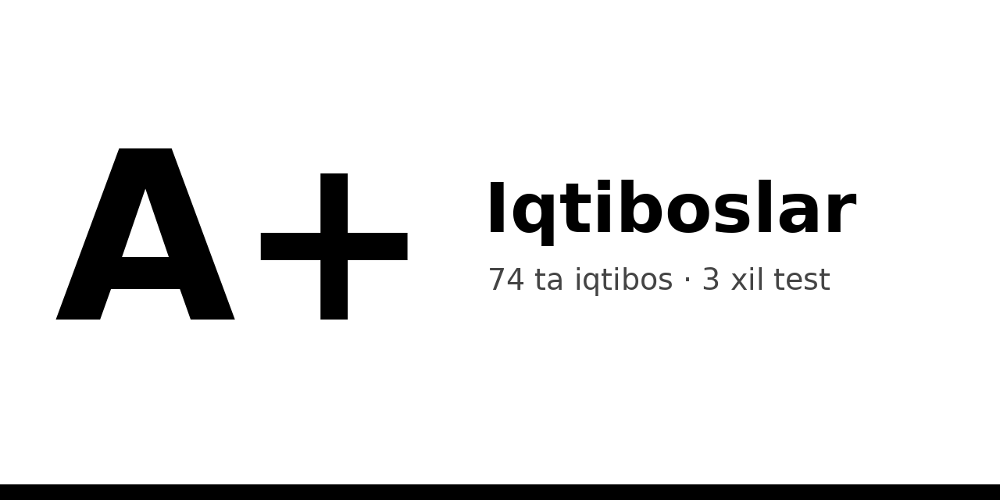

# Iqtiboslar

Mashhur shaxslarning 74 ta iqtibosi asosida tuzilgan oʻquv ilovasi. Bitta HTML sahifa, oʻrnatish shart emas. Telefonda "Bosh ekranga qoʻshish" orqali oddiy ilova kabi ochiladi va internetsiz ishlaydi.

## Imkoniyatlar

- **Bu kimning soʻzlari?** Iqtibos koʻrsatiladi, muallifni 4 ta variantdan topasiz (10 ta savol).
- **Moslashtirish:** 5 ta iqtibosni 5 ta muallif bilan juftlaysiz (3 tur).
- **Shu kishining soʻzlarini toping:** muallif beriladi, uning iqtiboslarini belgilaysiz (8 ta savol).
- **Iqtiboslar roʻyxati:** barcha iqtiboslar, soʻz yoki muallif boʻyicha qidiruv bilan.

Eng yaxshi natijalar brauzerda saqlanadi.

## Ishga tushirish

`index.html` faylini brauzerda oching (Chrome, Safari, Firefox). Oflayn rejim (service worker) faqat GitHub Pages kabi `https` manzilda ishlaydi.

## GitHub Pages orqali joylashtirish

1. Barcha fayllarni repozitoriyga yuklang.
2. **Settings → Pages** boʻlimiga kiring.
3. **Source**: **Deploy from a branch**, branch `main`, papka `/ (root)`. **Save** bosing.
4. Bir necha daqiqadan keyin ilova `https://<foydalanuvchi>.github.io/<repozitoriy>/` manzilida ochiladi.
5. Repozitoriy sahifasida **Settings → General → Social preview** ga `social-preview.png` ni yuklang. Havola ulashilganda shu rasm chiqadi.

## Fayllar

| Fayl | Vazifasi |
|---|---|
| `index.html` | Butun ilova |
| `manifest.webmanifest` | Telefonga ilova sifatida qoʻshish sozlamalari |
| `sw.js` | Oflayn ishlashi uchun kesh |
| `icon.png` | Asosiy ikonka, 1024 px (repozitoriy/profil rasmi uchun) |
| `icon-192.png`, `icon-512.png`, `icon-maskable-512.png` | Ilova ikonkalari |
| `apple-touch-icon.png` | iPhone bosh ekrani ikonkasi |
| `favicon.ico`, `favicon-32.png` | Brauzer tabidagi ikonka |
| `social-preview.png` | Ulashishda chiqadigan rasm (1280×640) |
| `.nojekyll`, `.gitignore` | GitHub Pages va git sozlamalari |

## Iqtibos qoʻshish

`index.html` ichidagi `RAW` roʻyxatiga `["Muallif","Iqtibos matni"]` koʻrinishida yangi qator qoʻshing.
